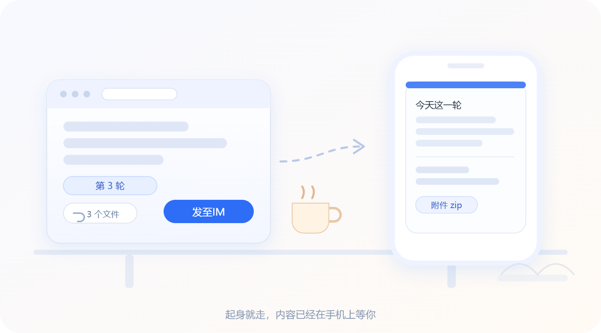
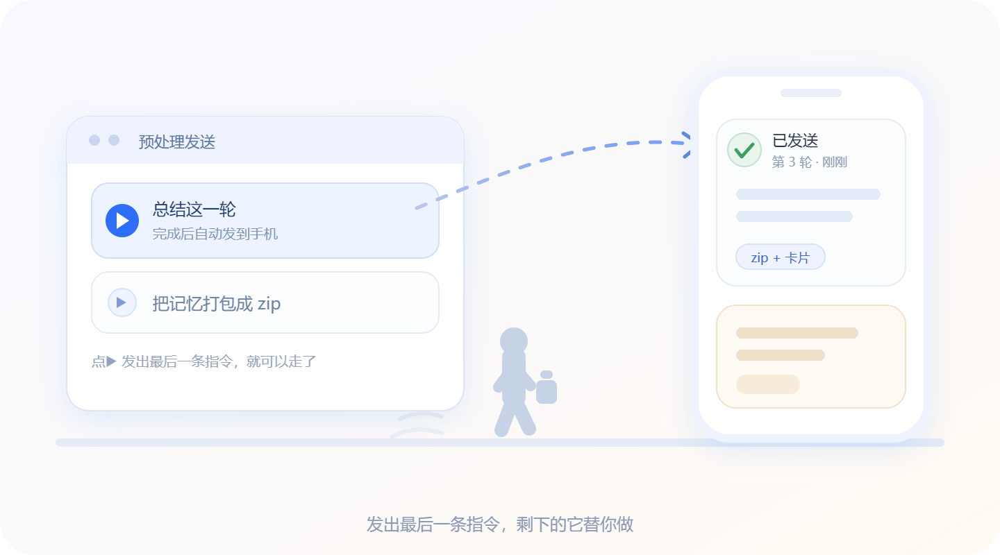
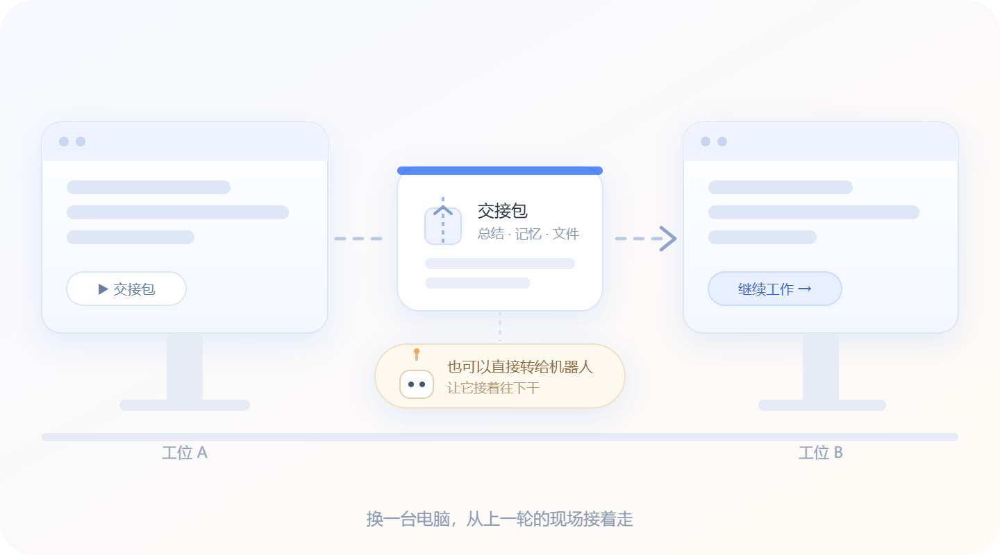

# dsh-read-it-later

[中文](README.md) · **English**

[](https://github.com/jes-phd/dsh-read-it-later/releases)
[](LICENSE)
[](https://github.com/jes-phd/dsh-read-it-later/stargazers)
[](https://github.com/jes-phd/dsh-read-it-later)
[](#binding)

> Turn every conversation turn into something you can pick up and keep going with on another device.

One click at the **end of each turn** sends that turn's **prompt, reply and attachments** to a bot you bound yourself — Feishu, WeChat, Telegram, Discord or DingTalk.
It is not built for collaboration, it is built for **you**: standing up, commuting, switching computers — the content is already there.



## 1. Read it later

Halfway through a meeting, halfway through a plan — and you have to leave for the commute, for lunch, for the office.
Click "Send to IM" and this turn's result and files land on your phone: read on the way, keep working when you arrive.

## 2. Send automatically after a queued prompt

Save what you do often as a **preset**: summarize this turn, pack the memory into a zip, write a handoff note…



Click ▶ to push the prompt into the session, then you can leave — when it finishes, the plugin sends that turn's result and attachments to IM by itself.
**Sending the last instruction is the moment you leave.**

## 3. Session relay

Continue on another computer without re-explaining everything from scratch.



On the old machine, run the "cross-device handover" preset — the result is zipped and sent to IM. Open it on the new machine and let the new session read it, then carry on.
You can also forward the handoff package straight to an IM bot and let it take over.

## Install

```bash
git clone https://github.com/jes-phd/dsh-read-it-later.git
cd dsh-read-it-later
npm install --omit=dev
```

Then install that directory as a bundle with DSH's plugin manager (`install_bundle`), or search for `dsh-read-it-later` in the plugin marketplace.

## Three steps to start

| Step | What to do |
| --- | --- |
| 1 | On any turn, click "⚙ Bind & settings" → scan to bind Feishu or WeChat (no need to dig through DSH settings) |
| 2 | Day to day: at the end of a turn, click "📤 Send to IM" and tick the prompt / reply / attachments you want |
| 3 | Before leaving: click "Queue & send", pick a preset card ▶ and fire it — the rest is handled for you |

## Binding

### Feishu

Scan with the Feishu app and confirm on your phone; Feishu's official device registration (`archetype=PersonalAgent`) then **creates and binds a custom app named "专属 AI 助手" for you automatically**, requesting only the scopes needed to send:

- `im:message:send_as_bot`
- `im:resource`

The returned `app_id` / `app_secret` / `open_id` are stored locally. You can also use "Manually bind a Feishu app" and type App ID / App Secret / open_id yourself.

### WeChat

Scan with WeChat (Tencent iLink bot API `ilink/bot/get_bot_qrcode`); after confirming you get a `bot_token` plus the scanner's `ilink_user_id`, so the bot can message you proactively — **it does not need to receive a message from you first**. If your phone shows a pairing code, type it into the settings panel.

### Telegram / Discord / DingTalk

These three need no QR code — fill in the credentials under "Manual bind":

| Platform | What to provide | Notes |
| --- | --- | --- |
| Telegram | Bot Token (from @BotFather) | If Chat ID is left empty, send the bot any message in Telegram first, then click "Save & verify" — the chat is discovered automatically |
| Discord | Bot Token + Channel ID | Right-click the channel → Copy Channel ID; the bot needs permission to post there |
| DingTalk group bot | Webhook URL (optional signing secret) | Text only; attachments are written into the body as a file list |

With several bots bound, click "Make default" in the list — the send panel preselects it.

### Where credentials live

`~/.dsh/read-it-later/bots.json` (mode 0600, written via temp file + rename). RPC only ever returns redacted bot info (no appSecret / token).

## Settings

At the bottom of the "⚙ Bind & settings" panel is **Advanced settings**: three toggles, a wait limit, the two status-monitor toggles, and 10 color themes (theme swatches and the project link share one row).

Advanced settings are **locked** by default (greyed out, read-only): open the project page and give it a Star, then come back — it unlocks automatically.
**Both status-monitor toggles are off by default** and also require unlocking.
Everything is stored in `~/.dsh/read-it-later/settings.json`:

| Setting | Default | Checked | Unchecked |
| --- | --- | --- | --- |
| Show summary `summarize` | ✅ on | Card holds a ≤100-character summary of the prompt and of the reply, plus a collapsible "📄 Details" panel | Prompt and full reply are laid out in the card directly (truncated past 6000 characters), no details panel |
| Compress attachments `zip` | ✅ on | All attachments are packed into one `<session title> turn N.zip` | Every file is sent separately, like earlier versions |
| Random theme `randomTheme` | ✅ on | FNV-1a hash of the **session title** picks the theme: stable per session, as distinct as possible across sessions (easy to tell apart in Feishu) | Use the fixed theme picked below |
| Unlocked `unlocked` | ❌ off | Set to `true` after opening the project page; advanced settings become editable | — |
| Wait limit `autoTimeoutMin` | 20 minutes | Longest wait after a queued send (1–180, adjustable); on timeout it says "waiting timed out, you can click again" instead of hanging | — |
| Notify on finished turn `monitorTurns` | ❌ off (needs unlock) | Watches **all** DSH sessions; when any turn finishes, sends the default bot a short "✅ Turn finished · title" message (with turn number, time, workspace) | No notifications |
| Push options when stuck `monitorAsk` | ❌ off (needs unlock) | When a session sits on a "waiting for your decision" (question / approval) for over a minute, the **question and options** are sent to the default bot so you can go back and pick | No push |

| id | Name | Accent | Feishu card template |
| --- | --- | --- | --- |
| `default` | Starry blue | `#2f6df6` | `blue` |
| `lavender` | Lavender | `#8b5cf6` | `violet` |
| `butter` | Butter | `#c99a12` | `yellow` |
| `mint` | Mint | `#0f9d76` | `green` |
| `rose` | Rose | `#d94b7c` | `carmine` |
| `sky` | Sky | `#0e8f9e` | `turquoise` |
| `sunset` | Sunset | `#d8641b` | `orange` |
| `indigo` | Indigo | `#4f46e5` | `indigo` |
| `ice` | Ice | `#3d8fd1` | `wathet` |
| `graphite` | Graphite | `#5b6570` | `grey` |

Clicking a color **switches random theme off** and pins that color; while random theme is on, the color this session resolves to is marked "← this session".

The bottom of the panel is the project link (`GITHUB_URL` in `lib/settings.mjs`). Advanced settings stay locked until you open the project page.

## Status monitoring (optional)

The two "Status monitoring" toggles under "⚙ Bind & settings → Advanced settings" both push to the **default bot**:

- **Notify on finished turn**: scans every session active within the last 3 days (at most 25 per tick, only re-reading logs whose size changed) and sends `✅ Turn finished · title / turn N · time / workspace` when a session completes a turn.
- **Push options when stuck**: when it finds an unanswered question / undecided approval after the last `turn/end` that has been quiet for over a minute, it sends the question, up to 8 option texts, and a line on how to reply.
- **Answer right in Feishu**: the stuck-notification card lists options as `1 / 2 / 3` — **just reply with the number** (or the option text) and the plugin matches it to the most recent unanswered card and writes the choice back into the original session; it replies "Filled back into the session: X".

Implementation: `monitor-scan.py` (returns only conclusions: did this turn finish, what is it stuck on) plus `lib/monitor.mjs` (one tick per 45 seconds, state in `~/.dsh/read-it-later/monitor.json`, the same question or turn is never pushed twice; turning a toggle on triggers a catch-up scan so sessions that were already stuck are not missed). To trigger a scan manually: RPC `monitor.tick`.

## What it looks like when sent

- **Feishu**: one message = **one compact card** — title is the DSH session title, subtitle is "turn N · YYYY-MM-DD HH:mm"; the body shows **a ≤100-character summary of the prompt and of the reply** by default, with the full reply folded inside a "📄 Details: full reply" panel (tables inside it are converted to a compact list, because Feishu cards do not allow `table` inside `collapsible_panel`); the file list sits after both summaries and before the details panel, **on one line, comma-separated, with the size in parentheses**, no previews; attachments are packed into **one zip** by default (named `<session title> turn N.zip`, stored in `~/.dsh/read-it-later/outbox/`) and sent as a separate file message after the card — turn "Compress attachments" off to send them one by one. The card color is derived from the session title by default (stable per session); you can turn randomness off in advanced settings and pin a theme. If the card fails to send it falls back to plain text automatically.
- **WeChat**: plain text (split at 1800 characters) plus file messages (`getuploadurl` → AES-128-ECB upload → `sendmessage`).
- Limits: zip up to 100 MB; if zipping fails it falls back to sending files individually (10 files / 25 MB each).

---

# Technical details (safe to skip)

## RPC

The Host registers `POST /api/read-it-later`; the client calls it with `connection.rpc.call('/api', 'read-it-later', { method, payload })` using the official envelope:

```
request  { type:'client-request',  rpcId, method:'read-it-later', payload:{ method, payload } }
response { type:'server-response', rpcId, result:{ ok:true, value } | { ok:false, error:{ code, message, details } } }
```

Methods: `status`, `bind.begin`, `bind.poll`, `bind.verify`, `bind.cancel`, `bind.manual`, `bot.remove`, `bot.rename`, `bot.test`, `bot.default`, `share.preview`, `share.send`, `preset.list`, `preset.save`, `preset.delete`, `auto.arm`, `auto.status`, `auto.cancel`, `settings.get` (optionally with `{sessionId}` to get that session's resolved theme), `settings.set` (partial `themeId` / `randomTheme` / `summarize` / `zip`).

### Status monitoring

| method | Description |
| --- | --- |
| `monitor.status` | Whether it runs, the interval, sessions scanned last tick, current toggle values, state file path |
| `monitor.tick` | Scan and push immediately (without waiting for the 45-second tick) |

### Diagnostics

`debug.controller` → `{ hasController }`: whether the host exposes the session controller (needed to write Feishu card selections back into a session).

### Auto-send after a queued prompt

`preset.*` read and write `~/.dsh/read-it-later/presets.json` (three defaults are written on first use: ① cross-device offline handoff package, ② todo list, ③ this-session summary markdown).

`auto.arm { sessionId, botId?, include }` records how many turns the session has completed (the `turns` baseline); the Host then decodes the session log every 3 seconds, and as soon as a new `turn/end` appears it assembles **that turn** into a card (plus a file message) per `include` and sends it to the bot, ending in state `done`. After 20 minutes it becomes `timeout`; `auto.cancel` cancels at any time, and `auto.status` reports `{armed,state,baseline,result,error}`.

The client clicks a preset in this order: `auto.arm` (to take the baseline) → `session.prompt([{type:'text',text}],'queue')`. So **it refuses while the session is running** (the result would otherwise map to the previous turn) and the UI says "wait until this turn finishes".

The `share.*` `payload` accepts `{ sessionId, turn, seq, include:{prompts,answers,files} }`; `turn` is the turn number in the log and `seq` is the sequence number of that turn's last node (when both are given, `seq` decides the turn).

## Layout

```
index.js              Host entry (inject: connection)
client.js             Browser side: per-turn button + settings page
lib/rpc.mjs           /api/read-it-later handler, send orchestration, auto polling
lib/collect.mjs       Session data collection (sessionQuery service / python fallback)
lib/card.mjs          Feishu card + plain-text rendering
lib/feishu.mjs        Feishu device registration, send message, send file
lib/weixin.mjs        WeChat iLink: QR code, polling, send text/file
lib/bind.mjs          QR binding orchestration (background poll, pairing code, store)
lib/store.mjs         bots.json read/write
lib/presets.mjs       Preset prompts presets.json read/write (3 defaults)
share-extract.py      Session log deframing (multi-frame zstd), filter by turn/seq
monitor-scan.py       Scanner answering "did this turn finish / what is it stuck on"
lib/monitor.mjs       Status monitoring: 45-second tick, dedupe, push to IM
lib/asks.mjs          "Waiting for your decision" records (for write-back), asks.json
lib/feishu-events.mjs Feishu long connection: card button clicks / text replies → write choice back into the session
tests/                smoke-bind (binding), smoke-client (slot registration), smoke-rpc (presets + auto-send), smoke-monitor (scanner + monitor status), smoke-answer (text reply → write-back)
```

## Development

```bash
node --check client.js
node tests/smoke-client.mjs     # slot registration and component rendering
node tests/smoke-rpc.mjs        # RPC / presets / auto-send
node tests/smoke-auto.mjs       # auto-send baseline must come from the log's turn count (regression)
node tests/smoke-restore.mjs    # resume unfinished auto-sends after a restart (expired → timeout)
node tests/smoke-monitor.mjs    # status monitoring: stuck questions are detected with options, no longer stuck after answering
node tests/smoke-bind.mjs       # real network: Feishu/WeChat QR codes + error paths
```

The plugin is installed into the profile as a workspace package via `link:`:

```bash
# inside DSH:
plugin_manager action:install_bundle target:"E:\DSHproject\DSH Im\packages\dsh-read-it-later"
# reload after code changes:
plugin_manager action:set_plugin target:"include:dsh-read-it-later" enabled:false
plugin_manager action:set_plugin target:"include:dsh-read-it-later" enabled:true
```

Refresh the page after changing client-side code.

## Support this project

If it saved you some shuffling back and forth, a [Star on GitHub](https://github.com/jes-phd/dsh-read-it-later) is all it takes — that is also how "advanced settings" unlock.

## License

[MIT](LICENSE) © 2026 jes-phd
