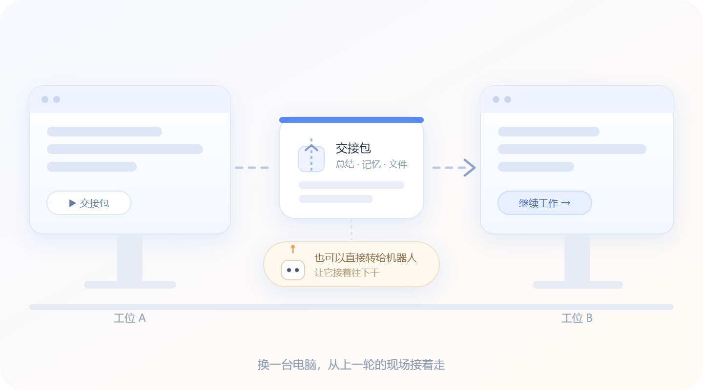

# dsh-read-it-later

> 把每一轮对话，变成你换设备时能接着读、接着干的东西。

在会话的**每一轮结尾**点一下，就能把这一轮的**提示词、回复、附件**发到你自己绑定的飞书或微信机器人。
它不为协作，只为**你自己**：起身、通勤、换台电脑，内容已经在那儿了。


## 一、稍后读

会议开到一半、方案写到一半，要起身去通勤、去吃饭、去公司。
点「发至IM」，这一轮的结果和文件就落在手机上 —— 路上读，到了公司接着用。

## 二、预处理后自动发送

把常做的事存成「预处理」：总结这一轮、把记忆打包成 zip、写一份交接说明……


点 ▶ 把提示词送进会话，然后就可以走了 —— 它跑完，插件自动把这一轮的结果和附件发到 IM。
**发出最后一条指令，就是离开的时刻。**

## 思考中也能先点

一轮还没答完（DSH 正在思考）时，输入框上方会出现同一套样式的一行：`Read it later ——— 📤 本轮结束后发送`。
点开勾好「提示词 / 回复 / 附件」后按「本轮结束后发送」，插件会先在 Host 记下这次预约（落盘，重启也不丢），**这一轮回答一结束就立刻发过去**，你不用守在屏幕前等它跑完。

回答结束后，这一行自动消失，改由每条回答下面的 `发至IM` 按钮接管——两处入口发出去的内容完全一样。

## 三、会话接力

换一台电脑继续，不必从零解释前情。



在旧电脑上点 ▶ 跑一遍「跨设备交接」，结果打包成 zip 发到 IM；在新电脑打开它，让新的会话读一遍就能接着干。
也可以把交接包直接转给 IM 机器人，让它接着往下做。

## 安装

```bash
git clone https://github.com/jes-phd/dsh-read-it-later.git
cd dsh-read-it-later
npm install --omit=dev
```

然后在 DSH 里用插件管理器把这个目录当 bundle 装上（`install_bundle`），或在插件市场搜索 `dsh-read-it-later`。

## 三步开始

| 步骤 | 做什么 |
| --- | --- |
| 1 | 任意一轮点「⚙ 绑定设置」→ 扫码绑定飞书或微信（不用去翻 DSH 设置） |
| 2 | 平时：每轮结尾点「📤 发至IM」，勾选要发的提示词 / 回复 / 附件 |
| 3 | 离身前：点「预处理发送」，挑一张预处理卡 ▶ 发出，剩下的交给它 |

## 绑定

### 飞书
用飞书 App 扫码，手机确认后由飞书官方 device registration（`archetype=PersonalAgent`）**自动创建并绑定一个名为「专属 AI 助手」的自建应用**，申请人只勾选发送所需权限：

- `im:message:send_as_bot`
- `im:resource`

拿到 `app_id` / `app_secret` / `open_id` 后写入本机。也可以「手动绑定飞书应用」直接填 App ID / App Secret / open_id。

### 微信
用微信扫码（腾讯 iLink 机器人接口 `ilink/bot/get_bot_qrcode`），确认后拿到 `bot_token` + 扫码者 `ilink_user_id`，之后主动给扫码者本人发消息，**不需要先收到他的消息**。若手机提示配对码，在设置页输入即可。

### 凭据存放
`~/.dsh/read-it-later/bots.json`（0600，写入用临时文件 + rename）。RPC 只返回脱敏后的机器人信息（不含 appSecret / token）。

## 设置

「⚙ 绑定设置」面板最下面的「高级设置」：三个开关 + 10 套配色。

高级设置默认**锁着**（灰色、不可改）：点开项目主页点个 Star，回到面板就自动解锁。
全部写在 `~/.dsh/read-it-later/settings.json`：

| 设置项 | 默认 | 勾选 | 不勾选 |
| --- | --- | --- | --- |
| 摘要显示 `summarize` | ✅ 开 | 卡片只放提示词/答复各 100 字摘要 + 「📄 详情」折叠面板 | 直接把提示词与完整答复铺在卡片里（超过 6000 字截断），不再有详情面板 |
| 压缩附件 `zip` | ✅ 开 | 所有附件打成一个 `<会话标题>第 N 轮.zip` | 像早期版本一样每个文件单独发 |
| 随机配色 `randomTheme` | ✅ 开 | 按**会话标题**做 FNV-1a 散列取色：同一会话颜色固定，不同会话尽量不同色（飞书里一眼区分） | 用下面手动选的固定配色 |
| 解锁 `unlocked` | ❌ 关 | 点开项目主页后置为 `true`，高级设置可改 | — |
| 等待上限 `autoTimeoutMin` | 20 分钟 | 预处理发送后最多等这么久（1–180 可调）；超时会明确提示「等待结果超时，可以再点一次」，不会无限挂着 | — |
| 完成一轮就通知 `monitorTurns` | ❌ 关 | 盯着**所有** DSH 会话，任何一轮跑完就给默认机器人发一条「✅ 完成一轮 · 会话标题」的短消息（带第几轮、时间、工作区） | 不通知 |
| 卡住时推选项 `monitorAsk` | ❌ 关 | 会话停在「等你决定」（提问 / 审批）超过 1 分钟，就把**问题和选项**发到默认机器人，提示你尽快回去选 | 不推送 |

| id | 名称 | 主色 | 飞书卡片 template |
| --- | --- | --- | --- |
| `default` | 星野蓝 | `#2f6df6` | `blue` |
| `lavender` | 淡紫 | `#8b5cf6` | `violet` |
| `butter` | 淡黄 | `#c99a12` | `yellow` |
| `mint` | 薄荷绿 | `#0f9d76` | `green` |
| `rose` | 玫瑰粉 | `#d94b7c` | `carmine` |
| `sky` | 天青 | `#0e8f9e` | `turquoise` |
| `sunset` | 落日橙 | `#d8641b` | `orange` |
| `indigo` | 靛蓝 | `#4f46e5` | `indigo` |
| `ice` | 冰蓝 | `#3d8fd1` | `wathet` |
| `graphite` | 石墨灰 | `#5b6570` | `grey` |

点任意颜色会**自动关掉随机配色**并固定成该颜色；随机配色开着时，当前会话命中的颜色旁边标「← 本会话」。

面板底部是项目地址（`lib/settings.mjs` 的 `GITHUB_URL`）。高级设置默认锁着，点开项目主页即解锁。

## 状态监控（可选）

「⚙ 绑定设置 → 高级设置」里的「状态监控」两个开关，都推到**默认机器人**：

- **完成一轮就通知**：扫描最近 3 天内活跃的所有会话（每轮最多 25 个，只解「体积变了」的日志），某会话成功收完一轮就发 `✅ 完成一轮 · 标题 / 第 N 轮 · 时间 / 工作区`。
- **卡住时把选项推给你**：发现「最后一次 turn/end 之后还有没回答的提问 / 没审批的审批」，且已经安静超过 1 分钟，就把问题、最多 8 个选项原文发过去，并附一句怎么回。
- **在飞书里直接选**：卡住提醒卡片里把选项按 `1 / 2 / 3` 列出来，**直接回复数字**（或选项原文）即可，插件会对上最近一张还没答完的卡片并把选择写回原会话，选完会回你一条「已回填到会话：X」。

实现：`monitor-scan.py`（只输出结论：这一轮跑完没有、卡在什么上）+ `lib/monitor.mjs`（45 秒一拍，状态存 `~/.dsh/read-it-later/monitor.json`，同一提问 / 同一轮不会重复推；刚打开开关时会补扫一次，不会漏掉早就卡住的会话）。手动触发一次扫描：RPC `monitor.tick`。

## 发送效果

- **飞书**：一条消息 = **一张紧凑大卡片** —— 标题是 DSH 会话标题，副标题是「第 N 轮 · 年-月-日 时:分」；正文默认只显示**提示词摘要 + 答复摘要（各 100 字以内）**，完整回复收在卡片内可展开的「📄 详情：完整回复」面板里（点开即见，正文里的表格会在面板内转成紧凑列表，因为飞书卡片不允许 `collapsible_panel` 里嵌 `table`）；文件列表放在两个摘要之后、「详情」面板之前，**横排、逗号分隔、名字后括号写大小**，卡片里不预览；附件默认打成**一个 zip**（命名 `<会话标题>第 N 轮.zip`，存放在 `~/.dsh/read-it-later/outbox/`）作为独立文件消息跟在卡片后面，关掉「压缩附件」则逐个发送。卡片颜色默认按会话标题随机取（同一会话固定），也可以在「高级设置」里关掉随机、手动固定一套配色。卡片发送失败自动回退纯文本。
- **微信**：纯文本（1800 字分段）+ 文件消息（`getuploadurl` → AES-128-ECB 上传 → `sendmessage`）。
- 文件上限：zip 100 MB；zip 失败时回退逐个发送（10 个 / 单个 25 MB）。

---

# 技术细节（普通用户可以跳过）

## RPC

Host 注册 `POST /api/read-it-later`，客户端用 `connection.rpc.call('/api', 'read-it-later', { method, payload })` 调用；协议为官方信封：

```
请求 { type:'client-request',  rpcId, method:'read-it-later', payload:{ method, payload } }
应答 { type:'server-response', rpcId, result:{ ok:true, value } | { ok:false, error:{ code, message, details } } }
```

方法：`status`、`bind.begin`、`bind.poll`、`bind.verify`、`bind.cancel`、`bind.manual`、`bot.remove`、`bot.rename`、`bot.test`、`share.preview`、`share.send`、`preset.list`、`preset.save`、`preset.delete`、`auto.arm`、`auto.status`、`auto.cancel`、`settings.get`（可带 `{sessionId}` 拿该会话的实际配色）、`settings.set`（`themeId` / `randomTheme` / `summarize` / `zip` 部分更新）。

### 状态监控

| method | 说明 |
| --- | --- |
| `monitor.status` | 是否在跑、间隔、上次扫描数、两个开关当前值、状态文件位置 |
| `monitor.tick` | 立刻扫一遍并推送（不等 45 秒的那一拍） |

### 诊断

`debug.controller` → `{ hasController }`：宿主是否暴露了会话控制器（飞书卡片点选要靠它把回答写回会话）。

### 预处理自动回传

`preset.*` 读写 `~/.dsh/read-it-later/presets.json`（首次使用自动写入 3 条默认预设：① 跨设备离线交接包、② 待办清单、③ 本会话总结 MD）。

`auto.arm { sessionId, botId?, include }` 先记下当前会话已完成的轮次数（`turns` 基线），然后 Host 每 3 秒解一次会话日志；一旦出现新的 `turn/end`，就把**那一轮**按 `include` 组装成一张卡片（+ 文件消息）发给机器人，状态变为 `done`。超时 20 分钟变 `timeout`，`auto.cancel` 可随时取消，`auto.status` 查询 `{armed,state,baseline,result,error}`。

客户端点预设的顺序是：`auto.arm`（拿基线）→ `session.prompt([{type:'text',text}],'queue')`。因此**会话正在运行时不允许点**（否则结果会对应到上一轮），界面会提示「等这一轮结束后再点」。

`share.*` 的 `payload` 支持 `{ sessionId, turn, seq, include:{prompts,answers,files} }`；`turn` 数字对应日志里的轮次，`seq` 是该轮最后一个节点的序号（两者都给时优先 `seq` 归属）。

## 目录

```
index.js              Host 入口（inject: connection）
client.js             浏览器侧：每轮按钮 + 设置页
lib/rpc.mjs           /api/read-it-later 处理器、发送编排、auto 轮询
lib/collect.mjs       取会话数据（sessionQuery 服务 / python 兜底）
lib/card.mjs          飞书卡片 + 纯文本渲染
lib/feishu.mjs        飞书 device registration、发消息、发文件
lib/weixin.mjs        微信 iLink：二维码、轮询、发文本/文件
lib/bind.mjs          扫码绑定编排（后台轮询、配对码、写库）
lib/store.mjs         bots.json 读写
lib/presets.mjs       预处理预存提示词 presets.json 读写（默认 3 条）
share-extract.py      会话日志解帧（多帧 zstd），按 turn/seq 过滤
monitor-scan.py       会话「跑完没有 / 卡在什么上」的扫描器
lib/monitor.mjs       状态监控：45 秒一拍、去重、推 IM
lib/asks.mjs          「等待你决定」的提问记录（回填用），asks.json
lib/feishu-events.mjs 飞书长连接：卡片按钮点击 / 文字回复 → 回填会话选择
tests/                smoke-bind（绑定）、smoke-client（槽注册）、smoke-rpc（预设+自动回传）、smoke-monitor（扫描器+监控状态）、smoke-answer（文字回复→回填）
```

## 开发

```bash
node --check client.js
node tests/smoke-client.mjs     # 槽注册与组件可渲染
node tests/smoke-rpc.mjs        # RPC / 预设 / 自动回传
node tests/smoke-auto.mjs       # 自动回传的基线必须取到日志轮次（regression）
node tests/smoke-restore.mjs    # 重启后把没等完的自动回传接回来（过期标 timeout）
node tests/smoke-monitor.mjs    # 状态监控：卡住的提问能被识别并带选项，回答后不再报卡住
node tests/smoke-bind.mjs       # 真实网络：生成飞书/微信二维码 + 错误路径
```

插件以 workspace 包 + `link:` 方式装进 profile：

```bash
# 在 DSH 里：
plugin_manager action:install_bundle target:"E:\DSHproject\DSH Im\packages\dsh-read-it-later"
# 改代码后重载：
plugin_manager action:set_plugin target:"include:dsh-read-it-later" enabled:false
plugin_manager action:set_plugin target:"include:dsh-read-it-later" enabled:true
```

改完前端需刷新页面。

## 支持这个项目

如果它替你省下了来回倒腾的时间，去 [GitHub 点个 Star](https://github.com/jes-phd/dsh-read-it-later) 就够了 —— 这也是「高级设置」解锁的方式。

## 许可证

[MIT](LICENSE) © 2026 jes-phd
